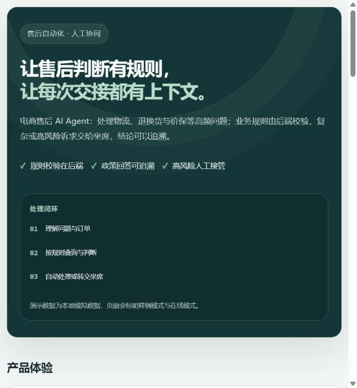
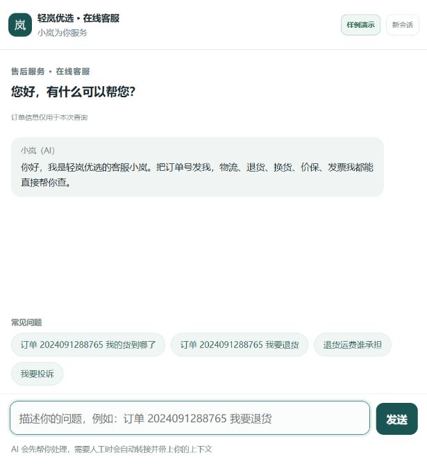
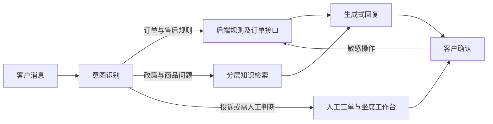

# 电商售后客服 Agent

面向电商售后流程的 AI Agent 产品原型，覆盖意图识别、订单规则校验、知识检索、退款二次确认与人工接管。项目展示了如何把可确定的业务判断交给后端规则，把自然语言交互交给大模型。

> **项目范围：**当前版本可在本地运行。订单、政策和测试数据均为演示样例，不连接真实店铺，也不会提交真实退款。

<p align="center">
  
</p>

<p align="center">
  
</p>

## 核心能力

| 模块 | 能力 |
|---|---|
| 意图分流 | 识别物流查询、退换货、价保、通用咨询、投诉、人工转接和确认提交等场景 |
| 规则校验 | 由后端按订单状态和政策判断资格、金额及时效；敏感操作经过明确确认 |
| 知识检索 | 将商品信息、售后政策与服务流程分层检索，支持回答常见政策问题 |
| 人机协作 | 创建带上下文的工单，坐席可接管会话、回复客户并跟进处理状态 |
| 运营观测 | 提供客户端、坐席工作台和指标看板，并配套意图与检索评测样例 |

## 处理流程



## 演示场景

| 场景 | 处理方式 |
|---|---|
| 查询物流进度 | 根据订单样例返回物流状态 |
| 申请退货或换货 | 按订单条件给出资格和下一步 |
| 申请价保 | 区分官方调价与活动降价，按规则处理 |
| 咨询商品或政策 | 从对应知识库检索答案 |
| 投诉或复杂问题 | 创建工单并转交坐席，保留对话上下文 |

在本地客户端选择「样例演示」，可不配置大模型密钥体验基础流程。演示模式使用本地样例规则，不会产生真实退款或外部工单。

## 本地运行

需要 Python 3.10 及以上版本。

```bash
cd mock-api
python -m pip install -r requirements.txt
python -m uvicorn main:app --host 0.0.0.0 --port 8000
```

打开 <http://localhost:8000/>，可进入项目首页；客户页面、坐席工作台和指标看板分别位于 `/client`、`/console`、`/dashboard`。

接入 Dify 在线工作流时，在项目根目录配置 `.env` 中的 `DIFY_APP_KEY` 与 `DIFY_API_BASE`，再按 [Dify 配置清单](docs/03-Dify搭建清单.md) 导入 `dify/after-sales-agent.yml`。密钥仅保存在本地环境变量中。

## 验证

在项目根目录运行：

```bash
python tools/validate_assets.py
python tests/smoke_test.py
```

意图评测需要启动后端并配置 Dify：

```bash
python tools/eval_intent.py
```

## 项目结构

```text
dify/       Dify Chatflow 工作流
mock-api/   FastAPI 模拟订单与售后接口
web/        客户端、坐席工作台和指标看板
prompts/    意图分类与回复提示词
kb-assets/  知识库素材生成、清洗与评测
tests/      后端回归测试和意图评测样例
tools/      环境检查、资源校验和评测工具
docs/       需求、架构、PRD、测试与上线方案
```

## 设计文档

- [需求与指标定义](docs/01-需求与指标.md)
- [系统架构与设计决策](docs/02-架构图.md)
- [Dify 配置清单](docs/03-Dify搭建清单.md)
- [订单测试场景](docs/04-订单测试数据.md)
- [人工接管流程](docs/05-转人工流程与坐席话术.md)
- [产品需求文档](docs/07-PRD产品需求文档.md)
- [上线与灰度方案](docs/09-上线与灰度方案.md)
